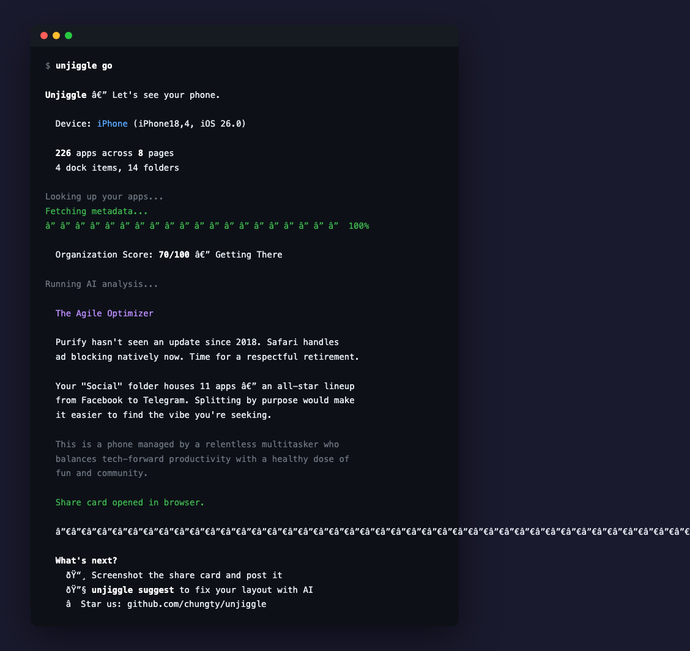

# Unjiggle

See what is taking up space on your iPhone home screen before you move a single icon. Unjiggle is an open-source macOS CLI that reads your layout over USB, scores it, and shows you where the extra swipes come from. You decide whether to change anything.

**No phone handy?** Try the sample layout first. It needs no device, API key, or AI service.

<a id="quick-start"></a>

## Try the demo

On macOS with Python 3.10+:

```bash
python3 -m venv .venv
source .venv/bin/activate
python -m pip install unjiggle
unjiggle demo
```

You will see a sample home screen score and diagnostics, including estimated wasted swipes. This does not connect to a phone or change a layout.

<p align="center">
  
</p>

## Scan your own layout

Only after you choose to share your layout with the CLI: connect your iPhone by USB, tap **Trust This Computer**, and run:

```bash
unjiggle scan
unjiggle score
```

These commands read your layout; they do not rearrange icons. `scan` shows pages and apps; `score` gives an organization score. App metadata lookups may use the network. Your phone may contain personal app and folder names, so check what you share with an assistant or in a report.

`unjiggle go` is a separate, opt-in report flow: it can send layout data to an AI provider if an API key is present in your environment, writes reports locally, opens a share card, and may ask about analytics. Do not use it as an unannounced read-only scan.

Want an assistant to walk you through the same steps? Start with the [Claude, Codex, and Cursor guide](docs/AI-ASSISTANTS.md). For the website, see [unjiggle.com](https://unjiggle.com/?source=github-readme).

## A CLI walkthrough from Leo

[Leo (@runes_leo)](https://x.com/runes_leo/status/2076675326814675289) reports using the CLI to organize 304 apps across three pages; see [Leo's step-by-step tutorial](https://x.com/runes_leo/status/2076969856319320502). This is Leo's reported result, not a guaranteed outcome for another phone. iOS may reflow icons after a layout write, so review the result on your device. No images from those posts are reproduced here.

## Commands and API

### Diagnostics

| Command | What it does |
|---------|-------------|
| `unjiggle go` | Full scan, score, analysis, and report |
| `unjiggle scan` | Show the current home screen layout |
| `unjiggle score` | Compute the organization score |
| `unjiggle analyze` | AI observations about the current layout |
| `unjiggle mirror` | Personality-style diagnostic from the app collection |
| `unjiggle obituary` | Dead-app graveyard analysis |
| `unjiggle swipetax` | Estimate wasted swipes per year |
| `unjiggle report` | Generate a shareable report card |
| `unjiggle demo` | Run the CLI without a phone |
| `unjiggle safety-test` | Check reads and save a verified backup; does not write to the phone |

### Layout writes and backups

| Command | What it does |
|---------|-------------|
| `unjiggle suggest` | Interactive suggestions; can call AI and write changes after confirmation |
| `unjiggle suggest --apply-all` | Apply the full suggested transform |
| `unjiggle backup` | Save the current layout before changes |
| `unjiggle restore` | Write a saved backup; exits unsuccessfully if the read-back state differs |
| `unjiggle safety-test --write-roundtrip` | Offer a write test after a backup and explicit confirmation; can change the layout |

`safety-test` checks reads and a local backup by default. It does not test the write path. With `--write-roundtrip`, the confirmation defaults to **No**. Even writing unchanged input can make iOS add or move icons. A failed test does not undo the write, and a passing immediate read-back does not guarantee the layout will stay unchanged after reboot.

If the layout changes while a backup is being verified, the command stops before writing and keeps the original backup rather than replacing it. An explicit round-trip also stops if the layout has changed since that backup. Refresh and review the layout before deciding on another operation.

The interactive `restore` command requires an exact read-back match, including icon-state metadata. It fails conservatively even if a difference might be cosmetic; it does not report extra apps as a successful restore. Keep both backups and stop after a mismatch. Do not automatically retry or restore again: another write can repeat the problem. These safeguards do not prevent iOS icon repopulation or establish a safe recovery procedure for an affected phone.

### Machine API

`unjiggle json ...` exposes structured output for external clients.

`unjiggle json inventory` reads installed app identifiers and names alongside a
Home Screen snapshot. Each app includes `on_home_screen`; the response also lists
Home Screen IDs missing from the installation lookup in `unmatched_home_screen_ids`.
An app absent from the Home Screen is only a candidate for App Library: this read
does not verify its icon or whether iOS can place it on a page. The command never
writes to the device or sends the inventory to an AI provider.

`unjiggle json check-library-insertion` accepts
`{"bundle_id":"...","target_page":0,"snapshot_id":"...","source_raw_sha256":"..."}`
or the same request with `"target_folder":"Existing Folder"` instead of
`target_page`. Choose exactly one destination. For a folder, the command requires
one uniquely named, structurally complete existing Home Screen folder. It fills
the last folder page first and projects a new folder page after nine icons.
The command checks one installed User app that occurs exactly once in a dict-format
icon state's `ignored` list. It projects removal from that list and addition to
the chosen destination, after checking the snapshot, installed identity, complete
structure, and capacity. It rereads the icon state after the installed-app
lookup. Its result always has `writable: false`: simulator state supports the
offline projection, but physical iPhone insertion, grid location, and recovery
remain unverified. This command does not write and cannot authorize `apply-checked`.

An experimental `unjiggle json apply-library-checked` accepts the single-app check's exact request and its `proposed_snapshot_id` and `proposed_raw_sha256`. It only runs when the request also contains `"experimental_library_write": true` **and** the process explicitly sets `UNJIGGLE_EXPERIMENTAL_LIBRARY_WRITE=1`. It rechecks the installed User app, source and proposed raw state, saves a verified backup and recovery journal, writes once, and requires an exact raw-state readback before issuing a `recovery` receipt compatible with `restore-checked`. This has been exercised only with an in-memory device; the environment gate is for isolated experiments and does not mean insertion or restore is safe on a physical phone. Keep client Apply disabled until physical placement and recovery have been established.

The read-only result includes `proposed_raw_sha256`, a fingerprint of the
complete projected icon state; it is evidence for comparison, not write permission.

`unjiggle json check-library-insertions` accepts the same snapshot and raw
fingerprint with `"insertions":[{"bundle_id":"...","target_page":0}, ...]`.
It returns a checked layout after each step, for up to fifty distinct installed
User apps in `ignored`. Its projections are read-only, and neither this command
nor `apply-checked` can use them to authorize writing these apps to an iPhone.
Each step also has a `raw_sha256` fingerprint, and the final fingerprint is
repeated in `proposed_raw_sha256` for exact-state comparison.

`unjiggle json check-mixed-operations` accepts a scan `snapshot_id`, its
`source_raw_sha256`, and one to fifty ordered `operations`. Each operation is
either `{"action":"move_to_page","bundle_ids":["..."],"target_page":0}`,
`{"action":"move_to_folder","bundle_ids":["..."],"folder_name":"Existing Folder"}`,
or `{"action":"insert_from_library","bundle_id":"...","target_page":0}`
(replace `target_page` with `"target_folder":"Existing Folder"` to insert
into a folder). Destinations must already exist when their step runs. The command
checks each move and Library addition against the preceding projected raw state,
then returns `steps` with the layout, snapshot ID, and raw SHA-256 after every
operation. The result includes the final layout and fingerprints and always has
`writable: false`. The command only reads the phone and installed inventory; its
projections do not establish physical placement or recovery and cannot authorize
any checked-write command.

An experimental `unjiggle json apply-library-batch-checked` accepts that check's
`insertions`, source snapshot and raw fingerprint, proposed snapshot and raw
fingerprint, plus `checked_step_raw_sha256` containing each step's `raw_sha256`
in order. It requires `"experimental_library_write": true` and
`UNJIGGLE_EXPERIMENTAL_LIBRARY_WRITE=1`. It rechecks the installed User apps and
every projected step against the checked plan, then makes a single backed-up,
journaled raw-state write with exact readback and a `restore-checked` recovery
receipt. Offline tests cannot prove physical icon placement or restore on an
iPhone; keep client Apply disabled until these are independently established.

`unjiggle json icon --bundle-id com.example.app` reads one icon from the connected
iPhone. It returns `{"bundle_id": "...", "png_base64": "..."}` with PNG bytes
encoded as base64, or `png_base64: null` when the icon is unavailable. It does
not change the layout. An icon alone does not prove that the app is visible in
App Library or can be added to the Home Screen. Icon images stay local unless
you explicitly share the JSON output.

Useful preset endpoints:
- `unjiggle json suggest --preset focus|relax|minimal|beautiful` for one preset preview
- `unjiggle json presets` for a batch of all built-in preset previews from one shared scan

In a transform preview, each entry of `changes` has `from_page` and `to_page` counted from 1, as the owner counts pages. A `delete` change also has `gratitude` and a `detail` line: a delete takes the icon off the home screen, and the app stays installed. The preview of `unjiggle json suggest --intent` also has `plan_warnings`: what the AI Stylist's plan asked for that the preview does not do, such as apps that did not fit on page 1. Each warning has a `kind`, a `message` and the `bundle_ids` that it is about.

`unjiggle.cli.JSON_CONTRACT` is the version of this contract (now 2). A client that bundles the engine can require a minimum version. Every `unjiggle json` command asks no question and writes exactly one JSON document to stdout. All other text goes to stderr. On failure, the document is `{"error": "..."}`, the message also goes to stderr, and the exit code is 1.

`unjiggle json apply` reads `{"operations": [...], "snapshot_id": "..."}` from stdin and applies all operations together, as the preview of `json suggest` shows them. `snapshot_id` is optional. Send the `snapshot_id` of the preview (from `json suggest` or `json presets`): when the layout on the phone changed after the preview, apply writes nothing and returns an error that starts with `Not written:`. Before it writes, it checks the new icon state: when that state would differ from the preview, would remove an icon that no operation names, or would add an app that is not on the home screen, it writes nothing and returns an error that starts with `Not written:`. Then it makes a verified backup, writes, and reads the layout back to compare it with the preview. Neither this command nor `unjiggle suggest` performs a separate round-trip test before the requested write. In the output, `backup` is the path of the backup of the layout before the command, also when nothing changed (`"changed": false`). `unjiggle json restore <backup>` attempts to restore it; another device write is required. When the write or the read-back check fails, the error also has `backup`.

For clients that need an exact reviewed destination, `unjiggle json check-operations` accepts operations and a required scan `snapshot_id`. It performs a read-only structural and transformation check and returns `proposed_snapshot_id` plus `source_raw_sha256` alongside the proposal. `unjiggle json apply-checked` requires those values with the same operations and source snapshot. It rereads the device, rejects a different raw source or projected destination, saves a verified backup, rereads once more before writing, and requires the full raw icon state to match the predicted write before returning a recovery receipt. It refuses App Library-only source apps. If iOS normalizes even unseen metadata, the write may have happened but the command reports failure and keeps the backup for manual review. The backup and read-back checks do not prove the icons' visible positions or that a subsequent restore will succeed. Both commands operate on the icon-state engine's supported transformations, not arbitrary installed-app placement.

For a read-only step sequence, set `include_steps` to `true` in the `check-operations` request (up to 50 operations). The response includes each operation-prefix layout projected from one device read. These projections do not certify visible iOS icon positions.

On successful `apply-checked`, the result also contains a `recovery` receipt. A client can pass that object on stdin to `unjiggle json restore-checked`. It verifies the original backup's bytes and complete source state, identifies the same phone by a hash of its device ID, refuses to overwrite any icon-state changes made after the apply, saves a new verified backup, checks again for drift, writes once, and requires the full raw source state on read-back. An incomplete or changed receipt fails without writing. A read-back mismatch after writing requires manual review; it does not trigger another write. This is an offline-checked safety boundary, not proof that a physical iPhone will render or recover its prior layout. Keep the receipt and both backup paths; a failed write never triggers an automatic retry. The older `json restore <backup>` remains available for manually reviewed recovery and does not provide these checked guards.

Before `apply-checked` writes, it saves a private, flushed `checked-recovery-*.json` journal beside the verified backup. This records the expected destination and original backup even if the process stops before sending a result; failure to save it stops the write. `restore-checked` now saves a second, reverse recovery journal beside its own verified pre-restore backup before attempting its write. If interrupted, this record can be audited against the exact post-restore state; it is labeled `operation: restore` in the pending list. Failure to save either journal stops that write. `unjiggle json pending-checked` lists journal paths and candidate `recovery` receipts from disk without contacting the phone. Pass a receipt to `unjiggle json check-recovery` on stdin to check its backup, original device identity, and exact current icon state without writing or creating another backup. A successful check establishes eligibility for a restore attempt at that moment, not physical recovery; `restore-checked` repeats the checks before writing. A journal does not prove the write happened or succeeded. Successful checked apply and restore responses include their `journal` paths.

`unjiggle json restore` refuses a backup with no apps on the home screen (an empty or damaged file), because it would take every icon off the home screen. Before it writes, it makes a verified backup of the layout on the phone, and returns its path as `undo_backup`. When the write or the read-back check fails, the error also has `undo_backup`. The restore writes each date of the backup (`iconModDate`) as a date, as the phone gave it, not as the text of the JSON file. It passes when the phone reads back as the backup. It accepts values of the icon state that SpringBoard changes on a write, when the dock, the pages, the folders and the widgets are the same.

On iOS 26, iOS can add an installed app from the App Library to the home screen when it gets a new layout. The read-back check of `json apply` and `json restore` accepts such apps when they are the only difference. Each one must be the plain icon of an App Store app (not a widget, a folder, a pinned icon, a second icon or an entry of another type), loose on a page, and not on the home screen of the preview (for `json apply`) or of the backup (for `json restore`). For `json apply`, it must also not be on the home screen before the write. All other icons must be in the positions of the preview or the backup. When the phone reads back the layout that it had before the write, the write had no effect, and the check fails. The engine does not move or remove these apps. The output lists them in the optional key `ios_added`, for example `[{"bundle_id": "...", "name": "...", "page": 2}]`, with the page counted from 1, and a short message goes to stderr. The key is not there when iOS added no app. All other differences still fail the check. `unjiggle suggest` uses the same check. In contrast, the interactive `unjiggle restore` and the explicit `safety-test --write-roundtrip` name recognized additions but fail when the read-back differs. The machine API's existing `ios_added` contract is unchanged; it reports tolerated additions, not their prevention.

## Requirements

- macOS
- iPhone connected via USB with "Trust This Computer" accepted
- Python 3.10+
- Optional, for AI features: `pip install 'unjiggle[ai]'` and an API key. With `ANTHROPIC_API_KEY`, layout analysis and the AI Stylist use Claude Opus 5.5 (`claude-opus-5-5`), and the Personality Mirror and the App Obituary use Claude Sonnet 5 (`claude-sonnet-5`). With `OPENAI_API_KEY`, every AI feature uses `gpt-4.1`. `--model` overrides the default, and a `claude-*` or `gpt-*` model name also selects the provider. Claude models need structured outputs: Claude Haiku 4.5, Sonnet 4.5, Opus 4.5 or newer. Never give an assistant your key in chat.

## How It Works

Unjiggle uses [pymobiledevice3](https://github.com/doronz88/pymobiledevice3) to communicate with iPhone SpringBoard services over USB. It reads `IconState`, enriches the layout with App Store metadata, computes diagnostics, previews transforms, and can apply changes after saving a backup. A backup does not guarantee that iOS will preserve the requested layout or that a later restore will succeed.

On supported macOS versions it can also read Screen Time data from `knowledgeC.db` for usage-aware suggestions. Otherwise it falls back to positional heuristics.

Share cards render to PNG via headless Chrome and copy cleanly to the macOS clipboard.

<a id="what-this-repo-owns"></a>
<a id="public-vs-private"></a>

## Contributing

This repository contains the CLI, layout engine, diagnostics, and JSON API. See [ARCHITECTURE.md](ARCHITECTURE.md) for its scope and [CONTRIBUTING.md](CONTRIBUTING.md) before changing commands or contracts.

## Project Links

- Website: [unjiggle.com](https://unjiggle.com)
- Repository: [github.com/chungty/unjiggle](https://github.com/chungty/unjiggle)

## License

GPL-3.0-or-later
